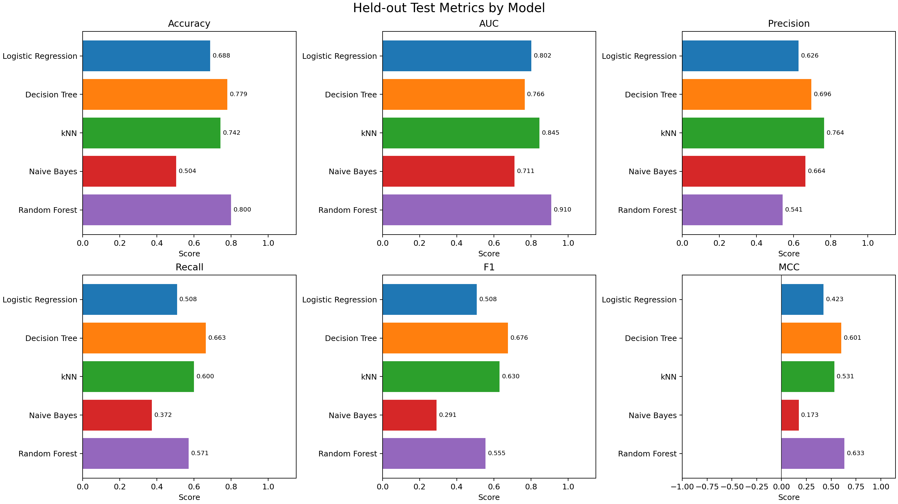

# Garment Employee Productivity Classification

## Problem statement

Classify garment-production team productivity into low, medium, or high categories using operational data, and compare five classification models on the same held-out test set.

## Dataset description

- **Source:** [UCI Productivity Prediction of Garment Employees](https://archive.ics.uci.edu/dataset/597); [dataset DOI](https://doi.org/10.24432/C51S6D).
- **Credit and license:** Productivity Prediction of Garment Employees (2020), UCI Machine Learning Repository; [CC BY 4.0](https://creativecommons.org/licenses/by/4.0/).
- **Size:** 1,197 rows, 14 input features and one original target.
- **Motivation:** Explore classification with data described by UCI as time-series data and apply the learning to other domains.
- **Target:** `actual_productivity`, converted into low (`< 0.40`), medium (`0.40 <= x < 0.80`), and high (`>= 0.80`). These thresholds were chosen for this project, not supplied by UCI.
- **Class distribution:** low 81 (6.77%), medium 550 (45.95%), high 566 (47.28%); the low class is underrepresented.
- **Feature types:** date, categorical, and numeric. The data contains 506 missing values in `wip` and no exact duplicate rows after categorical whitespace normalization.

UCI describes the original target as ranging from 0 to 1, but 37 dataset values exceed 1 (maximum approximately 1.1204). They are retained and labeled high.

## GitHub repository

<https://github.com/kunalroychoudhury/bits-wilp-2026ct05161-ml-assignment2>

The local files must be committed and pushed by the repository owner before they appear on GitHub. Grader access must also be verified.

## Setup and execution

The project has been tested with Python 3.12.0. From the project root:

```bash
python -m pip install -r requirements.txt
python -m model.preprocess
python -m model.train
python -m model.plot_metrics
```

`model.preprocess` writes `train_data.csv` and `test_data.csv`; `model.train` prints the evaluation table and saves metrics and fitted models under `model/results/`; `model.plot_metrics` generates the chart below from the saved metrics CSV. These commands overwrite their generated outputs. After rerunning the models, regenerate the chart and update the table and observations if results change. Run the assignment in BITS Virtual Lab and capture the execution for the required screenshot.

## Preprocessing and evaluation

The pipeline strips categorical whitespace, removes exact duplicates, drops `date`, and uses a stratified 80:20 train-test split with seed 42. Numeric missing values are filled with the training median and scaled using the training mean and standard deviation. Categorical missing values are filled with the most frequent training value and one-hot encoded. All learned transformations are fitted on training data only.

The split is random and stratified, not chronological; the results do not demonstrate forecasting on future dates. Each saved estimator expects the processed feature columns, not raw records.

## Models and results

All models use the same split. Logistic Regression uses `max_iter=1000` and seed 42; Decision Tree uses seed 42; kNN uses 5 neighbors; Naive Bayes uses GaussianNB; and Random Forest uses 100 trees and seed 42. Unspecified parameters use scikit-learn defaults.

Precision, recall, and F1 are macro-averaged across classes, giving each class equal weight despite the imbalance. AUC is multiclass one-vs-rest macro AUC based on predicted class probabilities. Accuracy and MCC are computed over the held-out test set. Precision is set to zero for a class if a model predicts no examples of that class.

| ML Model Name | Accuracy | AUC | Precision | Recall | F1 | MCC |
|---|---:|---:|---:|---:|---:|---:|
| Logistic Regression | 0.6875 | 0.8019 | 0.6264 | 0.5078 | 0.5079 | 0.4226 |
| Decision Tree | 0.7792 | 0.7659 | 0.6957 | 0.6633 | 0.6763 | 0.6012 |
| kNN | 0.7417 | 0.8452 | 0.7644 | 0.6000 | 0.6301 | 0.5312 |
| Naive Bayes | 0.5042 | 0.7115 | 0.6638 | 0.3723 | 0.2912 | 0.1731 |
| Random Forest | 0.8000 | 0.9103 | 0.5415 | 0.5705 | 0.5550 | 0.6333 |

### Metric visualization



The chart uses the full-precision values in `model/results/model_metrics.csv`; labels are rounded to three decimal places. MCC can range from -1 to 1; the other displayed metrics range from 0 to 1.

### Observations

| ML Model Name | Observation about model performance |
|---|---|
| Logistic Regression | Accuracy is 0.6875 and macro F1 is 0.5079; it identifies 1 of 16 low-class test cases (recall 0.0625). |
| Decision Tree | Has the highest macro F1 (0.6763) and macro recall (0.6633), with 0.7792 accuracy. It identifies 6 of 16 low-class cases (recall 0.3750). |
| kNN | Has the highest macro precision (0.7644), with macro F1 0.6301 and low-class recall 0.2500 (4 of 16). |
| Naive Bayes | Has the lowest accuracy (0.5042) and macro F1 (0.2912). It recalls all high-class cases but only 1 of 16 low-class and 6 of 110 medium-class cases. |
| Random Forest | Leads on accuracy (0.8000), AUC (0.9103), and MCC (0.6333), but identifies none of the 16 low-class cases, so its macro F1 is 0.5550. |
| Overall winner | **Decision Tree** for this comparison, prioritizing macro F1 because the low class is underrepresented. It performs better across classes by that measure, although its low-class recall is only 0.3750. Random Forest is preferable only if the priority is the higher observed accuracy or AUC, despite its failure to identify low-class cases. |

These are observations from one held-out split, not a guarantee of future performance. The winner was chosen after reviewing these test results; further independent evaluation would be needed to confirm it.

## Project layout

- `data/garments_worker_productivity.csv` — original UCI data.
- `train_data.csv`, `test_data.csv` — preprocessed training and test splits.
- `model/preprocess.py` — preprocessing and split creation.
- `model/train.py` and the five model modules — shared evaluation runner and model plugins.
- `model/plot_metrics.py` — visualization of all six comparison metrics.
- `model/results/` — generated metrics and fitted estimators.
- `requirements.txt` — direct runtime dependencies.
